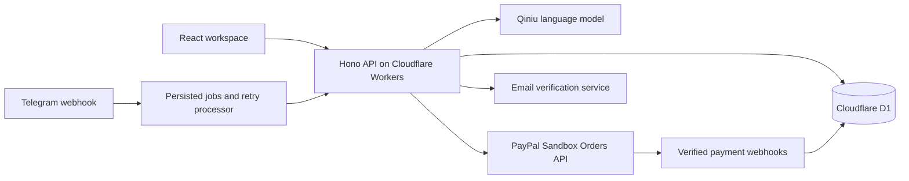

# Sahar

**From property enquiry to confirmed buyer intent.**

Sahar is a multilingual property enquiry assistant for Dubai real estate teams. Buyers describe their budget, preferred area and purchase timeline in web chat or Telegram. Sahar explains catalogue matches, records buyer intent and offers a PayPal Sandbox intent-deposit checkout after explicit confirmation. Completed payments update the order and flag the conversation for an agent.

[Open Sahar](https://sahar-agent.kioiskio.dev) · [Telegram](https://t.me/SaharDubaiAgentBot) · [Deployment guide](docs/DEPLOYMENT.md)

Built for the PayPal AI Hackathon. The hosted application uses a real language model and PayPal Sandbox APIs. Listings and images are illustrative; payments use test funds. Payment does not establish a property reservation, escrow arrangement or ownership right.

## Features

- **Multilingual conversations:** English, Arabic, Simplified Chinese, Traditional Chinese, French and German, including Arabic RTL. Replies follow the buyer's language rather than the interface language.
- **Grounded recommendations:** the model receives the configured catalogue and explicit currency units. Listing IDs and structured actions are validated by the server.
- **Consent-based checkout:** asking about a deposit does not create an order. Buyers confirm their intent, accept terms, approve in PayPal and complete capture after returning.
- **Payment reconciliation:** server-side amount checks, capture references, verified webhooks and idempotent state changes protect the workflow.
- **Agent handoff:** paid orders and handoff requests flag conversations for operator review. This is a workflow state, not a guarantee that an agent is immediately online.
- **Account workspace:** email-code sign-in, saved conversations, search, rename and deletion with ownership checks. Conversations with payment records have deletion safeguards.
- **Trial credits:** new accounts receive 50 credits. A successful AI reply uses one; failed requests release their reservation. Administrators grant credits with a required note and inspect account and credit history.

## Try the hosted application

1. Open the website and enter the workspace. Sign in with an email verification code after completing the verification challenge.
2. Ask: `My budget is AED 2 million. I want a one-bedroom apartment in Dubai Marina and plan to decide within three months. Explain your recommendation.`
3. Select Marina Sky Residence and ask about the deposit. The catalogue amount is USD 100.
4. Explicitly confirm that you want to proceed, open checkout and accept the terms.
5. Approve using a **PayPal Sandbox Personal buyer account**, return and capture the approved payment. A merchant's own Business account cannot pay that merchant.
6. Confirm **Paid**. An operator can inspect the associated order and handoff state.

The Telegram bot supports the same enquiry and Sandbox payment workflow. After payment or a human-agent request, AI replies pause and subsequent messages receive a status explanation. Send `/resume` to explicitly resume AI replies while retaining the order and history; `/start` displays the current status without cancelling a handoff. Operator-disabled AI and closed conversations remain restricted. Web credits and Telegram identities are separate; entering an email in chat does not link accounts. Request additional trial credits at [kioiskio01@gmail.com](mailto:kioiskio01@gmail.com).

## Workspace navigation

Sign-in opens buyer chat. Verified operators can select **Agent workspace** in the chat header (or the menu on mobile) to review orders and conversations. **Administration** manages accounts and credits. Checkout opened from an operator order returns to the order list; checkout opened from chat returns to that conversation. A short-lived, order-scoped cookie retains this destination across the PayPal round trip.

Real PayPal checkout is rendered by the server with native HTML forms. Viewing an order does not require JavaScript, images, application bundles or a PayPal API request. After accepting the terms, the buyer continues to PayPal; after approval, the buyer submits the capture form. Cancellation returns display a clear notice without changing a confirmed payment. Refreshing the page never submits a payment.

## Architecture



| Layer | Technology |
| --- | --- |
| Interface | React 19, TypeScript, Ant Design 6, i18next |
| Application | Hono, Cloudflare Workers, Vite |
| Persistence | Cloudflare D1, versioned SQL migrations |
| AI | Qiniu OpenAI-compatible API; `deepseek/deepseek-v4.1-flash-1017` |
| Payments | PayPal Sandbox Orders, capture and webhook verification |
| Messaging | Telegram Bot API |
| Sign-in | Email verification codes, server sessions, Cloudflare Turnstile |

The model proposes text, a lead score and a constrained action. It cannot choose the charged amount, grant credits or change access rights. Money is stored as integer minor units; model input uses explicit major-unit strings and currencies. Credits use reservations and an append-only ledger. Telegram updates and outbound deliveries have persisted retry state, processed by the Worker and scheduled maintenance handler.

## Run your own instance

Requires **Node.js 22.12 or later**, npm and a Cloudflare account. Full sign-in also requires a provisioned email-sending binding and Turnstile configuration; installing dependencies does not provide these services.

```sh
git clone https://github.com/kioiskio/sahar-agent.git
cd sahar-agent
npm ci
cp .dev.vars.example .dev.vars
npx wrangler login
npx wrangler d1 create sahar-agent
```

Set the returned database ID in `wrangler.toml`. Configure your application origin, administrator address, verified email sender and Turnstile site key. Fill in `.dev.vars` locally; never commit it. On PowerShell, use `Copy-Item .dev.vars.example .dev.vars`.

```sh
npx wrangler d1 migrations apply DB --local
npm run dev
```

Open the address printed by Vite. See the [deployment guide](docs/DEPLOYMENT.md) for email provisioning, secrets, production migrations and callbacks.

```sh
npm run typecheck
npm run build
```

CI installs locked dependencies, checks TypeScript and builds without provider credentials. A successful build does not prove external provider availability or payment completion.

## Configuration

| Setting | Purpose |
| --- | --- |
| `APP_BASE_URL` | Canonical origin for checkout returns and verification |
| `AUTH_SECRET` | Server-only secret for verification and session-related hashing |
| `ADMIN_EMAILS` | Operator email allowlist, checked on the server |
| `EMAIL_FROM`, `EMAIL` | Verified sender and provisioned email-sending binding |
| `TURNSTILE_SITE_KEY`, `TURNSTILE_SECRET_KEY` | Browser site key and server verification secret |
| `AI_PROVIDER`, `AI_BASE_URL`, `AI_MODEL` | Compatible protocol, endpoint and model ID |
| `AI_API_KEY` or `QINIU_SAHAR` | Worker secret or Secrets Store binding |
| `AI_DAILY_CALL_BUDGET` | Shared daily provider-call ceiling, including Telegram |
| `PAYPAL_CLIENT_ID`, `PAYPAL_SECRET`, `PAYPAL_WEBHOOK_ID` | Sandbox credentials and webhook registration |
| `TELEGRAM_BOT_TOKEN`, `TELEGRAM_WEBHOOK_SECRET` | Bot credentials and webhook authentication |

`AI_PROVIDER=openai` names the compatible protocol, not the hosting vendor. The hosted instance uses Qiniu. The public configuration contains placeholders, not production resource bindings or credentials.

## Source layout

```text
src/
  db/            Schema, migrations and data access
  i18n/          Server-side workflow translations
  lib/           AI, payments, sessions, credits and rate limits
  routes/        APIs, server-rendered checkout and provider webhooks
  services/      Conversation, payment and delivery workflows
web/
  components/    Shared brand, avatar and listing components
  messages/      Six interface translations
  pages/         Website, workspace, administration and checkout
public/          Local artwork, icons and privacy information
docs/            Deployment instructions
```

## Scope and operational limits

- The catalogue contains three sample properties. Availability, ownership, legal clearance and returns are not verified.
- PayPal uses Sandbox. Live collection, property escrow, production refunds and regulatory onboarding are outside this release's verified scope.
- Provider failures are surfaced to buyers. Limits, reservations and idempotency reduce abuse and duplicate processing; they do not eliminate every operational risk.
- Administration currently returns the latest 50 credit entries. It is not a complete accounting or billing system.
- Legacy simulator screens and compatibility adapters remain in the source. They are separate from signed-in AI chat and real Sandbox checkout and do not establish additional supported messaging channels.
- Email, model access, PayPal and Telegram require separately configured external services. Hosted-instance credentials are not distributed with the source.

## Security and license

See [SECURITY.md](SECURITY.md) for reporting issues. Do not post verification codes, checkout tokens, provider keys or user records in public issues.

Original source is available under the [MIT License](LICENSE). Third-party software, artwork and service marks retain their respective terms; see [THIRD_PARTY_NOTICES.md](THIRD_PARTY_NOTICES.md).
